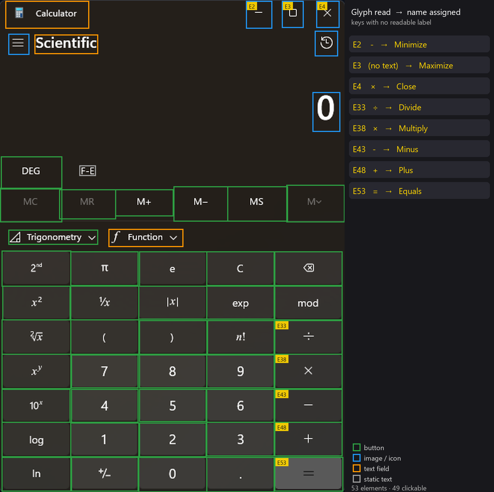
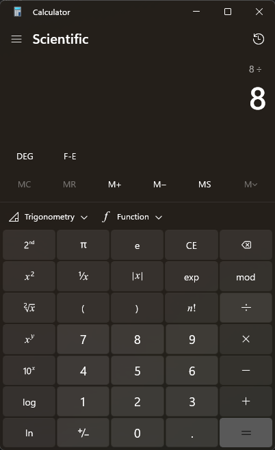
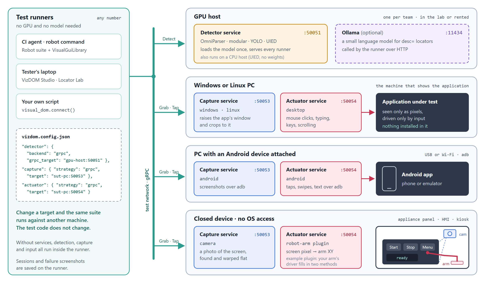

# VizDOM — GUI test automation from pixels

VizDOM turns a **screenshot** into a **Visual DOM**: every element with its bounds,
role, text, label, interaction flags, place in a hierarchy and ready-made
locators. A **Robot Framework library** then drives the application through that
DOM — click, type, wait, assert — so you can test applications that expose **no
accessibility tree**: custom-rendered Qt/OpenGL UIs, embedded and industrial
HMIs, remote desktops, or a screen seen through a camera.



*The Windows Calculator as VizDOM sees it, from pixels only: 53 elements, 49 of them
clickable. The operator keys have no readable label; VizDOM reads the glyph and
names the key (÷ → `Divide`), so a test can say `desc="divide button"`.*

**Documentation:** <https://milanac030988.github.io/vizdom/> ·
**Downloads:** [Releases](https://github.com/milanac030988/vizdom/releases)

---

## What you get

| | |
|---|---|
| **Robot Framework library** | `Library    VisualGuiLibrary` — 28 keywords: `Connect`, `Dump Visual DOM`, `Click Visual`, `Type Text Visual`, `Visual Should Exist`, `Wait Until Visual Appears`, `Verify Element Value`, `Bring App To Front`, … |
| **Locators** | `text=`, `hint=`, `role=`, `id=`, spatial (`within`, `right_of`, `below`, …), plain-language `desc="save button"`, and fallback chains `text=Save \|\| desc="save button"` |
| **An oracle you can trust** | A locator must resolve to **exactly one** element, or the step fails — an absent element is never reported as found |
| **VizDOM Studio** | Desktop app (Windows installer): capture an application, inspect its Visual DOM, try a locator live, export a Robot Framework resource, run the services |
| **Services** | Detector, capture and actuator as gRPC services, so the model runs on one GPU host and the clicks happen on the machine under test |
| **Platforms** | Capture and input on Windows, Linux (X11) and Android (adb); plugins for anything else (a camera, a robot arm) |

---

## Install

### Option 1 — VizDOM Studio (Windows, all-in-one)

Download **`VizDOM-Studio-Setup-<version>.exe`** from
[Releases](https://github.com/milanac030988/vizdom/releases) and run it. No
administrator rights are needed; nothing else has to be installed first. The
installer brings:

- VizDOM Studio;
- its own Python 3.12 with the VizDOM engine and the **Robot Framework library**;
- CPU-only PyTorch, EasyOCR with its English models, and Tesseract — so the first
  analysis works offline.

Your settings, sessions and plugins go to `Documents\VizDOM`. The installer is not
code-signed yet, so Windows SmartScreen asks once: *More info → Run anyway*.

To run Robot suites with the Python the installer brought, call it directly (the
default per-user install location is shown):

```bat
"%LOCALAPPDATA%\Programs\vizdom-studio\resources\python\python.exe" -m robot my_tests\
```

### Option 2 — Python package (Robot Framework library only)

For CI agents and test machines, install from [PyPI](https://pypi.org/project/vizdom/)
(Python 3.9+):

```bash
# CPU-only PyTorch first keeps the download small (EasyOCR runs on it)
pip install torch torchvision --index-url https://download.pytorch.org/whl/cpu

pip install "vizdom[robot]"
```

The same wheel is attached to every
[release](https://github.com/milanac030988/vizdom/releases) for machines without
access to PyPI.

| Extra | Adds |
|---|---|
| `robot` | everything a test machine needs: OCR (EasyOCR + Tesseract bindings), screen capture and input, the gRPC client |
| `grpc` | the detector / capture / actuator services and their clients |
| `omniparser` | the OmniParser detector (GPU recommended; see [OmniParser setup](https://milanac030988.github.io/vizdom/omniparser-setup/)) |
| `viewer` | the PyQt Visual DOM Viewer |

Tesseract is optional but improves hard-to-read text: install it from
[UB Mannheim](https://github.com/UB-Mannheim/tesseract/wiki) on Windows,
`apt install tesseract-ocr` on Debian/Ubuntu, `brew install tesseract` on macOS.

### Option 3 — from source

```bash
git clone https://github.com/milanac030988/vizdom.git && cd vizdom
uv venv --python 3.12
uv pip install -e ".[robot]"
uv run python scripts/gen_protos.py      # gRPC stubs, once after a checkout
```

The full guide (dependency groups, GPU notes, using an existing interpreter) is
[Setup](https://milanac030988.github.io/vizdom/uv-setup/).

---

## Quick start

### Robot Framework

```robotframework
*** Settings ***
Library    VisualGuiLibrary

*** Test Cases ***
Calculator Adds Two Numbers
    Connect                vizdom.config.json        # one file configures every stage
    Bring App To Front     Calculator
    Dump Visual DOM                                  # parse the screen once
    Click Visual           text=7 || desc="digit seven button"
    Click Visual           text="+" || desc="plus button"
    Click Visual           text=5
    Click Visual           text="=" || desc="equals button"
    Verify Element Value   text=12    12             # re-reads only that region
```

Clicks resolve against the DOM already parsed; the screen is parsed again only
when its layout changes. When a keyword fails, the library saves a screenshot of
the application window at that moment:



A complete, runnable suite is in
[`examples/windows_calculator_demo`](https://github.com/milanac030988/vizdom/tree/HEAD/examples/windows_calculator_demo/).

### Python

```python
from visual_dom import connect

session = connect("vizdom.config.json")      # or connect() for the defaults
dom = session.analyze("screenshot.png")      # -> Visual DOM (dict)
```

### Configuration

One JSON file drives every stage — detector, OCR, merging, hierarchy, capture,
input, `desc=` grounding. Generate an annotated template and edit it (or use
Studio's *Settings* page):

```bash
python -m visual_dom.config --init vizdom.config.json
```

Every option is described in
[Configuration & Sessions](https://milanac030988.github.io/vizdom/CONFIGURATION/).

---

## Deploying the infrastructure

On a single machine nothing has to be started: the Robot Framework library and
Studio run detection, capture and input **in process**. Split them up when the
detector should run on a GPU host, when one warm model should serve many test
runners, or when the machine under test is a different one from the runner.



| Service | Runs on | Start |
|---|---|---|
| **Detector** `:50051` | the GPU host (or any host, on CPU) | `vizdom-detector --backend omniparser --port 50051` |
| **Capture** `:50053` | the machine showing the application | `vizdom-capture --strategy windows --port 50053` |
| **Actuator** `:50054` | the machine receiving the clicks | `vizdom-actuator --strategy desktop --port 50054` |
| **Ollama** `:11434` *(optional)* | the GPU host | a small language model for the `desc=` tiers beyond the lexical one, e.g. `ollama pull qwen2.5:3b` |

Each command comes with the `grpc` extra (or the installer's Python); Studio's
*Services* page starts and stops the same services on the local machine. Then
point the test runner at them — in the config file:

```json
{
  "detector": { "backend": "grpc", "grpc_target": "gpu-host:50051" },
  "capture":  { "strategy": "grpc", "target": "sut-host:50053" },
  "actuator": { "strategy": "grpc", "target": "sut-host:50054" }
}
```

…or as library arguments:

```robotframework
Library    VisualGuiLibrary    capture=grpc    capture_target=sut-host:50053
...                            actuator=grpc   actuator_target=sut-host:50054
```

The test code does not change between a local and a distributed run.

**GPU host.** Install with the `grpc,omniparser` extras, fetch the OmniParser
weights once with `python scripts/setup_omniparser.py`, and start the detector with
`--backend omniparser`. The CPU backend (`--backend uied`) needs no weights.

> **Security.** The services have **no TLS and no authentication**, and listen on
> every network interface. The actuator executes the clicks and keystrokes it is
> sent. Run them only on a trusted, isolated test network, or behind a firewall
> that admits the test runners alone.

Details: [Using as a Client](https://milanac030988.github.io/vizdom/USAGE/) ·
[Architecture](https://milanac030988.github.io/vizdom/architecture/) ·
[Writing Plugins](https://milanac030988.github.io/vizdom/PLUGINS/)

---

## Results

Measured with the lifecycle benchmark in [`benchmarks/`](https://github.com/milanac030988/vizdom/tree/HEAD/benchmarks/): each step
locates an element, clicks it or checks it, and is scored on the outcome. Some
steps ask for an element that is **not** on the screen; reporting it as found is
a *false pass*, the worst failure a test tool can make.

| Set | Locator | Clicks on target | Correct verdicts | False passes |
|---|---|---|---|---|
| Synthetic UIs — 44 screens, 514 steps | `text=` | 0.916 | 0.957 | **0 of 88** |
| | `desc=` (lexical → small LM) | **0.958** | **0.973** | **0 of 88** |
| Real desktop applications — 46 screens of 9 apps, 998 steps | `text=` | 0.797 | 0.879 | **0 of 92** |
| | `desc=` (lexical → small LM) | 0.795 | 0.826 | **0 of 92** |

Detector: OmniParser's icon detector with VizDOM's OCR (`modular`). Parsing takes
about 2 s per screen on a 48 GB workstation GPU and about 15 s on a laptop CPU;
every later lookup on that screen is answered from the DOM in under a millisecond.
Methodology, per-application results and the other detectors:
[Evaluation](https://milanac030988.github.io/vizdom/EVALUATION/) and
[`benchmarks/README.md`](https://github.com/milanac030988/vizdom/blob/HEAD/benchmarks/README.md).

---

## Documentation

| Page | |
|---|---|
| [Setup](https://milanac030988.github.io/vizdom/uv-setup/) | Installing from source, dependency groups, GPU notes |
| [Configuration & Sessions](https://milanac030988.github.io/vizdom/CONFIGURATION/) | The session config, every option |
| [Using as a Client](https://milanac030988.github.io/vizdom/USAGE/) | Python API, Robot Framework keywords, remote services |
| [Writing Plugins](https://milanac030988.github.io/vizdom/PLUGINS/) | Your own capture source or actuator |
| [Architecture](https://milanac030988.github.io/vizdom/architecture/) | Ports and adapters, the gRPC services |
| [CV Pipeline](https://milanac030988.github.io/vizdom/PIPELINE/) | Screenshot → DOM, stage by stage |
| [Architecture Decisions](https://milanac030988.github.io/vizdom/adr/) | Why it is built this way |

---

## Building a release

The [Release workflow](https://github.com/milanac030988/vizdom/blob/HEAD/.github/workflows/release.yml) builds both downloads on
GitHub Actions. Pushing a tag publishes them:

```bash
git tag v0.2.0
git push origin v0.2.0
```

It generates the gRPC stubs, builds the wheel (engine + Robot Framework library),
then on a Windows runner assembles Python, the wheel, CPU PyTorch, the EasyOCR
models and Tesseract
([`tools/vizdom_studio/scripts/bundle_python.ps1`](https://github.com/milanac030988/vizdom/blob/HEAD/tools/vizdom_studio/scripts/bundle_python.ps1))
and packs them with Studio into the NSIS installer. Both are attached to the
GitHub Release, and once the installer has built, the wheel and source package
are uploaded to [PyPI](https://pypi.org/project/vizdom/). *Run workflow* on the
Actions tab builds everything without publishing.

PyPI uses trusted publishing, so no token is stored. One-time setup: on PyPI, add
a pending publisher (project `vizdom`, owner `milanac030988`, repository `vizdom`,
workflow `release.yml`, environment `pypi`), and create the `pypi` environment
under the repository's *Settings → Environments*.

---

## Author

**Nguyen Huynh Tri Cuong** — design and implementation of VizDOM, its Robot
Framework library and VizDOM Studio.

Issues and pull requests are welcome on
[GitHub](https://github.com/milanac030988/vizdom/issues).

---

## License

VizDOM is released under the [MIT License](https://github.com/milanac030988/vizdom/blob/HEAD/LICENSE).

Third-party components keep their own licenses. The Studio installer bundles
Python (PSF), PyTorch (BSD-3-Clause), EasyOCR (Apache-2.0), Tesseract
(Apache-2.0) and Electron (MIT). OmniParser is **AGPL-3.0** and is not
distributed with VizDOM: `scripts/setup_omniparser.py` fetches it on your
machine, and its license applies to that use.

---

## Acknowledgements

VizDOM builds on [UIED](https://github.com/MulongXie/UIED),
[OmniParser](https://github.com/microsoft/OmniParser) (AGPL-3.0, fetched
separately by `scripts/setup_omniparser.py`, not redistributed),
[EasyOCR](https://github.com/JaidedAI/EasyOCR),
[Tesseract](https://github.com/tesseract-ocr/tesseract) and
[Robot Framework](https://robotframework.org/).
